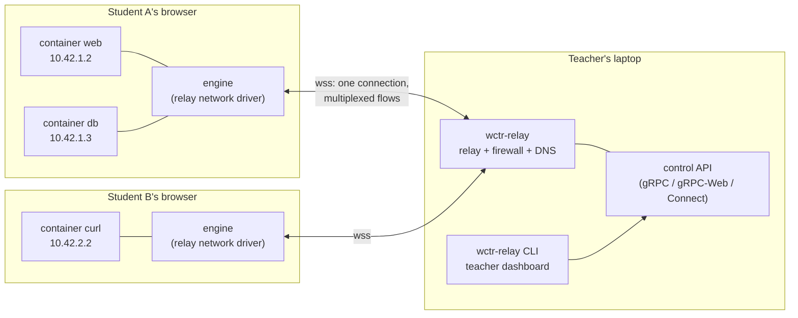
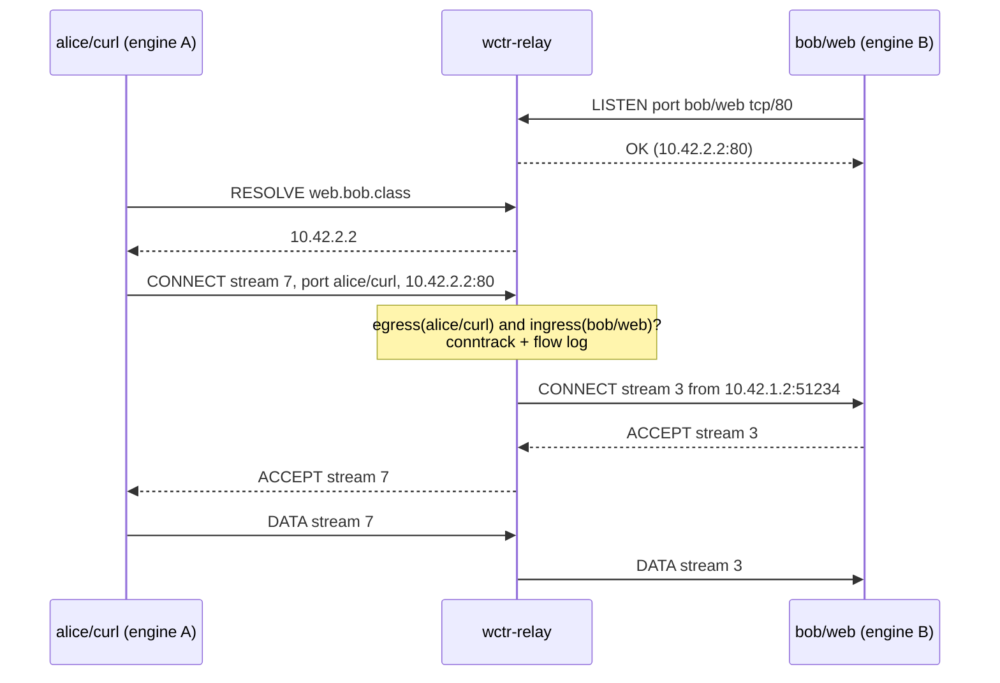


**Status: design, planned.** No code exists for anything on this page. It
decides what will be built and records why, so the implementation can be
reviewed against it. Milestones are named `M-relay-1` and up.


## The problem

A teacher has a laptop on the classroom LAN, possibly with no internet access.
Ten to forty students each open the playground in their own browser (Chrome,
Firefox or Safari, sometimes on a school-managed machine). Each browser runs
WASI containers in Web Workers. Inside one browser, containers already share a
virtual network. The lab now needs **student A's container to reach student
B's container**, for example a web server on one side and `curl` on the other,
and the teacher needs to **decide and show which flows are allowed**, the way a
cloud's security groups do.

The answer on this page: every browser opens **one secure WebSocket** to a
**relay** that runs on the teacher's laptop. The relay brokers socket-level
(L4) flows between containers, and it is also a **firewall**: every flow is
checked against **security groups** whose model is OpenStack Neutron's. The
teacher manages them through a **gRPC control API**. The brief called it the
"c-api"; this page reads that as **control API** (the control plane, as
opposed to the data plane that carries the containers' bytes).

## Decisions

| # | Question | Decision |
| --- | --- | --- |
| 1 | Browser to relay transport | **WebSocket over TLS (`wss`)**, one per browser, multiplexing every container's flows. WebTransport is the second transport, added later. WebRTC is not used. |
| 2 | Where the page comes from | **The relay serves the playground itself over HTTPS on the LAN**, with a classroom CA. Fallback: the page stays on GitHub Pages and connects to the relay, through WebTransport with certificate hashes where available. |
| 3 | Network model | **L4 flows**: the relay brokers `connect`/`listen`/datagrams between container endpoints, each with a virtual IP and a DNS name. No packet-level (L3) network stack in the engine. |
| 4 | Firewall model | Neutron's **networks, ports, security groups and rules**, allow-only, stateful by default, enforced at both ends of every flow, with flow logs. |
| 5 | Control API | **gRPC services**, served with Connect so the same handler answers gRPC, gRPC-Web and Connect; the teacher's CLI is a **separate cobra binary, `wctr-relay`**. |
| 6 | Identity | The relay assigns every address; nothing a browser sends about its own identity is trusted. Teacher: an admin token. Students: a class code exchanged for a short-lived session token. |

The docs repository has no ADR convention, so this table is the decision record.

## Topology



Traffic between two containers of the **same** browser does not leave it; the
engine checks it against the same rules (see [Where rules are
enforced](#where-rules-are-enforced)). Traffic between **different** browsers
always crosses the relay: a star, so the firewall sees every flow.

## 1. Transport between the browser and the relay

Three candidates were compared.

| | WebSocket (`wss`) | WebTransport | WebRTC data channels |
| --- | --- | --- | --- |
| Support | every browser the labs target | Chrome 97, Edge 98, Firefox 114, Safari 26.4 (iOS 26.4) per caniuse; MDN marks it Baseline 2026 ("since March 2026") | Baseline widely available since January 2020 (MDN) |
| In a Web Worker | yes | yes (MDN: the constructor is available in workers) | not established by MDN (an `RTCDataChannel` is transferable, which is not the same) |
| Certificate without a public CA | must be trusted by the browser | `serverCertificateHashes`: no CA needed, but strict constraints (below) | DTLS fingerprints from signalling |
| Multiplexing | ours, in the frames | native streams and datagrams (QUIC), no head-of-line blocking between streams | native channels |
| Firewall sees the traffic | yes, it terminates at the relay | yes | only if forced through the relay, which removes the reason to use it |

**`serverCertificateHashes`** lets a page connect to a server whose certificate
no CA signed, by giving the SHA-256 of the certificate. The W3C WebTransport
Candidate Recommendation (30 July 2026) and MDN set the constraints:

- the certificate **must be X.509v3**, its total validity period **must not
  exceed two weeks**, and the current time must be inside it;
- the accepted key algorithms are implementation-defined but **must include
  ECDSA P-256 (secp256r1)** and **must not include RSA**;
- the hash is **`sha-256`**, over the DER encoding of the leaf certificate;
- the option only works on a dedicated connection (`allowPooling: false`).

The relay can meet these: it generates an ECDSA P-256 certificate valid for at
most 13 days (a margin under 14) when a class starts, and hands its hash to
students in the join link. A class that lasts longer gets a new certificate
and a new link.

**WebRTC is rejected.** Its value is a direct peer-to-peer path; the firewall
must see every flow, so the topology would be a star through the relay anyway,
and WebRTC would only add ICE, DTLS and SCTP to a connection the relay
terminates. It is also not established that it can be used from the Web Worker
that runs the engine.

**Decision.** WebSocket is the first transport because it works in every
target browser, in a worker, and through the simplest server code. It carries
everything over one TCP connection, so one lost Wi-Fi frame stalls every flow
of that browser (head-of-line blocking); WebTransport removes that and is the
second transport (M-relay-4), selected per browser by feature detection, with
the same framing on its streams.

## 2. Reaching a LAN host from a web page

A page that talks to the teacher's laptop runs into four browser rules.

1. **Mixed content.** An `https` page cannot open `ws://`; MDN classes any
   non-upgradable insecure request as blockable, and the Local Network Access
   draft states that WebSocket has no `RequestInit`, so `ws://` URLs cannot
   use its mixed-content exemption either. The relay must speak **`wss`**, so it
   needs a certificate the browser accepts.
2. **Local Network Access** (formerly Private Network Access). The WICG draft
   (7 August 2026) classifies addresses as *loopback*, *local* (RFC 1918,
   link-local, `fc00::/7`) and *public*; a request from a document to a **less
   public** address space needs the `local-network` permission, only from a
   secure context. The WebSocket handshake is a fetch, so it is covered;
   WebTransport inherits the rule through fetch. Chrome's announcement says the
   permission **prompt launches in Chrome 142**, and in June 2025 it still
   listed WebSocket, WebTransport and WebRTC as not yet gated. The design
   assumes they are gated: a page on GitHub Pages (public) that opens a socket
   to `192.168.x.y` (local) triggers the prompt, and a school's enterprise
   policy may pre-deny it. A page served **from the relay itself** is in the
   local address space, so its connections back to the relay are not "less
   public" and need no permission.
3. **Cross-origin isolation.** The executor uses `SharedArrayBuffer`, which MDN
   allows only in a **secure context** that is **cross-origin isolated**. On
   GitHub Pages, which cannot set response headers, the playground gets this
   from coi-serviceworker; a relay serving the page sets
   `Cross-Origin-Opener-Policy` and `Cross-Origin-Embedder-Policy` itself.
4. **Certificate trust.** A WebSocket has no certificate-error interstitial
   to click through: either the browser already trusts the certificate, or the
   connection fails.

### Two deployments

| | (a) Page on GitHub Pages, relay on the LAN | (b) Relay serves the page over HTTPS |
| --- | --- | --- |
| Works without internet | no (the page and its assets come from GitHub Pages) | **yes** |
| Local Network Access prompt | **yes**, on every student browser; may be blocked by policy | **no** (same origin, same address space) |
| Cross-origin isolation | coi-serviceworker | response headers, no service worker |
| Certificate | WebTransport hashes (no trust needed), or a trusted certificate for `wss` | a certificate every student browser trusts |
| Version skew | page and relay released separately | the relay embeds one playground release: no skew |

**Recommendation: (b).** The relay embeds a pinned playground release and
serves it at `https://<relay-name>:8443/`. The certificate comes from a
**classroom CA** that `wctr-relay` creates once (mkcert's model: a local CA
installed in the trust stores, which issues the server certificate). Its root
certificate is what a school's IT installs on managed machines, by the same
policy channel that installs any CA. mkcert's README states the risk: the CA
key "gives complete power to intercept secure requests" from any machine that
trusts it, so the relay **name-constrains** the CA to the classroom's names
and addresses, keeps its key `0600` in the user's configuration directory,
never exports it, and `wctr-relay ca rotate` replaces it.

**Fallback: (a), with WebTransport and certificate hashes.** When no CA can be
installed (students' own machines), the page stays on GitHub Pages; the join
link carries the relay's address and certificate hash in the URL **fragment**
(never sent to any server). The student accepts the Local Network Access
prompt. A browser without WebTransport falls back to `wss`, which requires the
student to open `https://<relay>:8443/` once and accept the certificate
warning: the last resort, documented as such.

Whether a page loaded after a certificate warning is still a secure context
in each browser is **not established** by the references opened here; M-relay-3
measures it in the three browsers before (b) can rely on a click-through.

## 3. Network model: L4 flows, not L3 packets

The containers' sockets use the WasmEdge socket extension in the module
`wasi_snapshot_preview1`, as `github.com/stealthrocket/net` imports it:
`sock_open`, `sock_bind`, `sock_listen`, `sock_connect`, `sock_recv_from`,
`sock_send_to`, `sock_getaddrinfo`, `sock_shutdown`, plus `sock_getsockopt`,
`sock_setsockopt`, `sock_getlocaladdr` and `sock_getpeeraddr`. Its socket
types are **`SOCK_STREAM` and `SOCK_DGRAM` only**; there is no raw socket. The
engine therefore sees *a container connecting to 10.42.2.2:80*, never a packet.

The alternative is what container2wasm does: an L3 network stack based on
gVisor's netstack (`c2w-net`, built on gvisor-tap-vsock) that carries Ethernet
frames, forwarded over WebSocket in its `delegate=ws://...` mode.

| | L4 flows (chosen) | L3 packets (gVisor netstack) |
| --- | --- | --- |
| Fits the socket ABI | directly: one host call is one flow operation | needs a TCP/IP stack between the ABI and the wire |
| Firewall | sees connect, listen, port, peer: what a rule names | must reassemble flows from packets to say the same |
| Cost | one frame per write | TCP inside the container's stack, carried over the relay's TCP: TCP over TCP, retransmission on two levels, per-packet framing |
| Size in the browser | none beyond the driver | a whole network stack compiled into the engine |
| UDP | datagram frames | native |
| ICMP / ping | not expressible by the ABI (see below) | possible, but gvisor-tap-vsock says ICMP is not forwarded outside its network |

**Decision: L4.** Addressing is still IP-shaped, because the lab teaches it:

- one **network** per class, default `10.42.0.0/16`; student *n* gets
  `10.42.n.0/24`, the teacher `10.42.0.0/24`; the relay allocates every
  address (as Neutron allocates `fixed_ips`), the browser never chooses one;
- DNS: `<container>.<student>.class` resolves to the container's address,
  through `sock_getaddrinfo`, answered by the relay; a container's bare name
  still resolves inside its own browser;
- **TCP**: `listen` registers the address and port at the relay; `connect` is a
  request to the relay, which checks the rules and opens a stream to the
  listener's browser, or refuses (the caller gets `ECONNREFUSED`, or a timeout
  if the teacher chose "drop" for teaching);
- **UDP**: each `sock_send_to` is one datagram frame with a source and
  destination, at most 8 KiB; the relay checks it and forwards or drops it.

**Ping.** The ABI cannot send ICMP, so ping is taught through a small extension
the engine provides later (M-relay-5): an import module `wctr_net` with one
function, `icmp_echo(addr, seq, payload)`, which the driver turns into an echo
frame. The relay answers it on behalf of the destination port if its rules
allow ICMP echo ingress (`protocol: icmp`, `port_range_min: 8`, type 8). A
`ping` image built against it gives the expected pedagogy: allowed, the
student sees replies; removed, the pings time out, and the flow log shows the
drop.

## 4. Firewall model, mapped from Neutron

The Neutron API reference defines a **security group rule** by `direction`
(ingress or egress), `ethertype` (IPv4 or IPv6), `protocol` (`tcp`, `udp`,
`icmp`, ..., or `any`), `port_range_min` and `port_range_max` (for ICMP: the
ICMP type and code), and one of `remote_ip_prefix`, `remote_group_id` or
`remote_address_group_id`. A **security group** has a `stateful` flag: a
stateless group "bypasses connection tracking", so both directions of a flow
need rules. Nova's guide states the overall policy: "Security groups deny
everything by default, so rules indicate what is allowed", and adding a rule
is additive. A **port** carries `security_groups`, `fixed_ips`,
`port_security_enabled` ("security group rules and anti-spoofing rules are
applied") and `allowed_address_pairs`. Neutron creates, for each project's
`default` group, four rules (all IPv4/IPv6 egress, and ingress from ports in the
same group), and for other new groups only the two egress rules; a template of
those rules is configurable (`used_in_default_sg`, `used_in_non_default_sg`,
`remote_group_id: PARENT`). Quotas count `security_group` and
`security_group_rule` per project.

### Our resources

| Resource | Fields | Neutron counterpart |
| --- | --- | --- |
| `Class` | id, name, join code, state, quotas | project |
| `Network` | id, class, `cidr`, `dns_domain` (`class`), per-student prefix length | network + subnet |
| `Session` | id, student display name, label (`alice`), prefix, state, last seen | (none: a user) |
| `Port` | id, network, session, container name, `fixed_ip`, `security_groups`, `port_security_enabled` | port |
| `SecurityGroup` | id, class, name, description, `stateful` | security group |
| `SecurityGroupRule` | id, group, `direction`, `ethertype`, `protocol`, `port_range_min`, `port_range_max`, `remote_ip_prefix` or `remote_group_id`, description, `log` | security group rule |
| `DefaultRule` | the same fields, plus `used_in_default_sg`, `used_in_non_default_sg` | default security group rule |

A port is created when a container attaches to the class network and is
deleted with it. Only the teacher can set `port_security_enabled: false`.
There is no `allowed_address_pairs`: a container has exactly one address,
which the relay assigned.

### Policy and evaluation

- **Default deny.** A flow is allowed only if a rule allows it.
- **Both ends.** A flow from port S to port D is allowed iff **S's egress rules**
  allow it **and D's ingress rules** allow it, as Neutron filters at each port.
- **Order-free.** Rules only allow, groups on a port are a union, so there is no
  order to get wrong: the result is the same whatever order rules were added
  in. The decision names the rule that allowed it, or "no rule" if none did.
- **Default groups.** Each class gets a `default` group with Neutron's four
  rules (egress allowed, ingress from the same group), and the teacher can
  switch the class template to **isolated** (egress only to the teacher's
  subnet, no ingress), which is the better start for a lesson on opening ports.
- **`remote_group_id`** matches the current addresses of every port in that
  group, so a rule "ingress tcp 5432 from group `web`" follows containers as
  students start and stop them.

### Statefulness

Statefulness is **connection tracking of L4 flows**, which the relay has for
free because it brokers every flow:

- **TCP (stateful group):** the rules are checked once, at `connect`; the stream
  then carries both directions until either side closes.
- **UDP (stateful group):** an allowed datagram creates a conntrack entry keyed
  by the 5-tuple; replies match it; it expires after 30 s without traffic.
- **Stateless group:** for TCP, the reverse direction (D's egress, S's ingress)
  must be allowed too, or the connect is refused; for UDP, every datagram is
  checked both ways. This is Neutron's "two rules for a TCP flow", visible to
  students.
- **Rule changes:** after any change, the relay re-evaluates open flows and
  **resets** the ones no longer allowed, logging them as `revoked`. A firewall
  that silently keeps old connections confuses a lesson.

### Where rules are enforced

Between browsers, at the **relay**: it is authoritative. Inside one browser,
the **engine** applies the same rules, pushed by the relay with the session, so
that a lesson works the same with two containers of one student. That copy is
advisory: a student who modifies their own page only affects their own
containers, which they control anyway.

### Flow logs

Every decision can be logged: time, class, source and destination session,
port, address and port, protocol, verdict (`allow`, `deny`, `revoked`), the
matching rule or `no rule`, and at close the bytes each way and duration.
Rules carry a `log` flag; denies are always logged. The teacher streams logs
live (CLI, dashboard); a student sees the decisions about their own ports,
which is the point of the exercise ("why can't I reach Bob's server?").

### Quotas

Per class, as Neutron's: `security_group` (default 50), `security_group_rule`
(default 500), and `port` (default 40 × 10). Per session, for safety rather
than pedagogy: see the [security audit](#6-security-audit).

## 5. Control API

### Services

The control API is gRPC, described in one `.proto`; the relay serves it with
connect-go, whose handlers support gRPC, gRPC-Web and the Connect protocol and
mount on a plain `net/http` server. The Connect protocol uses no HTTP trailers
and supports server streaming over HTTP/1.1 (bidirectional streaming needs
HTTP/2), so a **browser dashboard** can call the same API, including the live
flow log, without a proxy. Nothing in the API needs bidirectional streaming.

```protobuf
syntax = "proto3";
package wasmcontainers.relay.v1;

service ClassService {
  rpc CreateClass(CreateClassRequest) returns (Class);       // teacher
  rpc GetClass(GetClassRequest) returns (Class);
  rpc RotateJoinCode(RotateJoinCodeRequest) returns (Class); // teacher
  rpc Join(JoinRequest) returns (JoinResponse);              // student: code -> session token
  rpc ListSessions(ListSessionsRequest) returns (ListSessionsResponse);
  rpc KickSession(KickSessionRequest) returns (Empty);       // teacher
}

service NetworkService {
  rpc GetNetwork(GetNetworkRequest) returns (Network);
  rpc ListPorts(ListPortsRequest) returns (ListPortsResponse); // student: own ports only
  rpc UpdatePort(UpdatePortRequest) returns (Port);            // security_groups, port_security_enabled
}

service SecurityGroupService {
  rpc ListSecurityGroups(ListSecurityGroupsRequest) returns (ListSecurityGroupsResponse);
  rpc CreateSecurityGroup(CreateSecurityGroupRequest) returns (SecurityGroup);
  rpc UpdateSecurityGroup(UpdateSecurityGroupRequest) returns (SecurityGroup);
  rpc DeleteSecurityGroup(DeleteSecurityGroupRequest) returns (Empty);
  rpc CreateRule(CreateRuleRequest) returns (SecurityGroupRule);
  rpc DeleteRule(DeleteRuleRequest) returns (Empty);
  rpc ListDefaultRules(ListDefaultRulesRequest) returns (ListDefaultRulesResponse);
  // Dry run: which rule, if any, would allow this flow, and at which end.
  rpc ExplainFlow(ExplainFlowRequest) returns (FlowDecision);
}

service FlowLogService {
  rpc WatchFlows(WatchFlowsRequest) returns (stream FlowEvent); // server streaming
}

message SecurityGroupRule {
  string id = 1;
  string security_group_id = 2;
  Direction direction = 3;            // INGRESS, EGRESS
  EtherType ethertype = 4;            // IPV4, IPV6
  Protocol protocol = 5;              // ANY, TCP, UDP, ICMP
  optional uint32 port_range_min = 6; // ICMP: type
  optional uint32 port_range_max = 7; // ICMP: code
  oneof remote {
    string remote_ip_prefix = 8;
    string remote_group_id = 9;
  }
  string description = 10;
  bool log = 11;
}

message FlowEvent {
  google.protobuf.Timestamp time = 1;
  string src_session = 2;  string src_port_id = 3;  string src = 4; // "10.42.1.2:51234"
  string dst_session = 5;  string dst_port_id = 6;  string dst = 7;
  Protocol protocol = 8;
  Verdict verdict = 9;     // ALLOW, DENY, REVOKED, CLOSED
  string rule_id = 10;     // empty: no rule matched
  uint64 bytes_out = 11;  uint64 bytes_in = 12;
}
```

The **data plane** is not gRPC: it is the binary framing on the WebSocket
(below), because it carries every byte the containers exchange and its cost
per frame matters.

### Authentication and authorization

| Principal | Credential | Can |
| --- | --- | --- |
| Teacher (local) | the Unix socket, mode `0600`, or the admin token over loopback | everything |
| Teacher (dashboard on another machine) | the admin token, as `Authorization: Bearer`, over TLS; opt-in with `--admin-listen` | everything |
| Student | a session token from `Join` | own ports, own flow decisions, read the groups that apply to them |

- The **admin token** is 256 random bits generated by `wctr-relay init`, stored
  `0600` under `os.UserConfigDir()`, compared in constant time, never printed
  except by an explicit `wctr-relay token show`, never in a URL.
- The **class code** (10 characters, from an alphabet without look-alikes) is
  shown on the teacher's screen and in a QR code. `Join` exchanges it with a
  display name for a **session token**: signed by the relay (Ed25519), bound to
  the class and the session id, valid 12 hours, revoked by `KickSession` or by
  rotating the code.
- **mTLS is not used for students**: provisioning client certificates into 40
  browsers is the problem the class code solves. A teacher may require mTLS on
  `--admin-listen`.
- Authorization is checked in the handler from the token's claims, never from a
  field of the request (a student cannot pass another session's id).

### The teacher's command line

A **separate binary, `wctr-relay`**, in its own repository
(`go-wasmcontainers/relay`, to be created), built with cobra like the rest of
the fleet. It is the relay daemon and its client, as `wctrd` and `wctr` are for
the engine, but in one binary because a teacher installs one thing. It stays out
of `wctr`, whose surface is compatible with the Docker Engine API and is what
students learn.

```text
wctr-relay init                          # classroom CA, admin token, state directory
wctr-relay serve [--listen :8443] [--admin-listen 127.0.0.1:8444]
wctr-relay class create "Networking 101" # prints the join link and QR code
wctr-relay class sessions | kick <student>
wctr-relay sg list | create <name> [--stateless] | delete <name>
wctr-relay rule add <sg> --ingress --proto tcp --port 80 --remote-group web
wctr-relay rule del <rule-id>
wctr-relay port list [--student alice] | set <port> --sg web,db
wctr-relay flows [--follow] [--deny-only] [--student alice]
wctr-relay explain alice/web bob/curl tcp/80
wctr-relay ca export | ca rotate
```

## Data plane framing

One WebSocket per browser, binary messages, one frame per message:

```text
 0      1      2              6              10
 +------+------+--------------+--------------+----------------+
 | type | flags| stream id    | length       | payload ...    |
 | u8   | u8   | u32 BE       | u32 BE       | <= 16 KiB      |
 +------+------+--------------+--------------+----------------+
```

Frame types: `LISTEN`, `UNLISTEN`, `CONNECT`, `ACCEPT`, `REFUSE`, `DATA`,
`WINDOW`, `CLOSE`, `RESET`, `DATAGRAM`, `RESOLVE`, `ECHO`, `POLICY`, `PING`.
Control payloads are protobuf messages from the same `.proto`; `DATA` payloads
are raw bytes. Flow control is credit-based per stream (64 KiB initial window,
`WINDOW` frames return credit) and per connection (1 MiB), so one fast sender
cannot fill the relay's memory for a slow reader. The relay rewrites every
source address: a frame names a stream or a port the session owns, never an
address the browser chose.



## 6. Security audit

The relay is a network service on a LAN full of untrusted clients, parsing
their frames. Every row is a requirement for the implementation and a test.

| Threat | Mitigation |
| --- | --- |
| A student impersonates another (identity, address) | Session token bound to the session; ports and addresses assigned by the relay; source addresses in frames ignored and rewritten; a port id in a frame must belong to the session (Neutron's anti-spoofing, without `allowed_address_pairs`). |
| A student claims another's DNS name | Names are `<container>.<student-label>.class`, the label fixed by the relay at `Join`; label collisions get a suffix. |
| Display names injected into the dashboard | Display names are data: length-limited (40), control characters removed, escaped by the dashboard; the label is derived, ASCII. |
| Brute-forcing the class code | 10 characters from 32 symbols (50 bits); `Join` rate-limited per source IP (5 per minute) and per class; the code expires with the class or on rotation. |
| Flooding and resource exhaustion | Per session: 256 open streams, 64 listeners, 32 pending connects, 10 ports, token buckets on frames per second (2 000) and bytes per second (2 MiB/s, burst 8 MiB), all configurable by the teacher. Per connection: 1 MiB of buffered data. Global: a cap on sessions (`port` quota) and on unauthenticated connections (32, 10 s to authenticate). |
| Oversized or malformed frames | WebSocket read limit of 16 KiB + header per message; a frame whose `length` disagrees with the message is a protocol error that closes the connection; every decoder fuzzed (`go test -fuzz`, corpus committed). |
| Slow readers (memory held) | Credit-based windows; a stream with no credit for 60 s is reset; WebSocket ping every 15 s, close after 45 s without a pong. |
| A malicious public page attacks the relay through a student's browser | Every API call and the WebSocket need a token in a header or in the first frame, never a cookie, so no ambient authority exists to ride (no CSRF). The WebSocket upgrade checks `Origin` against the relay's own origin and `https://go-wasmcontainers.github.io`. The `Host` header must be one of the relay's names or addresses (DNS rebinding). Local Network Access prompts are a second barrier, not the first. |
| The admin API reachable from the LAN | Off by default: the admin side listens on the Unix socket and loopback only; `--admin-listen` is explicit and can require mTLS. |
| Secrets | Admin token, CA key and token-signing key: `0600` files under `os.UserConfigDir()`, never in a URL, a command line, an environment variable or a log; logs redact anything token-shaped. Join links carry the code and the certificate hash in the URL fragment. The CA is name-constrained. |
| A compromised relay | It sees all classroom traffic by design. It runs as the teacher's user, needs no privilege (port 8443), and holds no credential beyond its own. |
| Supply chain | `govulncheck` in CI; dependencies limited to connect-go, protobuf, a WebSocket library and, later, quic-go/webtransport-go (which implements draft-16 of WebTransport over HTTP/3, not an RFC: pinned and re-checked when the draft moves). |

### Chaos cases

| Fault | Expected behaviour |
| --- | --- |
| A student reloads the page | The page reconnects with its session token; within a **120 s grace period** the relay keeps the session's ports and addresses; open streams are reset (the container sees a connection reset, as after a network cut); listeners are re-registered by the engine. |
| The teacher's laptop sleeps | Every WebSocket drops. On wake, browsers reconnect with exponential backoff and jitter (1 s to 30 s), so 40 browsers do not reconnect in the same millisecond; sessions older than the grace period are re-joined silently with the token. |
| The relay restarts or crashes | Classes, sessions, groups, rules, ports and address allocations are persisted (written to a temporary file, then renamed) after every change; tokens stay valid because the signing key is on disk. Flows do not survive: they are reset and logged as such. |
| Clock skew between machines | Tokens are checked against the relay's clock only; the browser's clock is never trusted. |
| Wi-Fi loss | Detected by the ping/pong timeout, handled as a reload. |
| Mixed versions (page and relay) | The first frame carries a protocol version; the relay refuses an unknown major version with a message the page shows. In deployment (b), skew cannot happen. |
| Two teachers' relays on one LAN | Each class has its own code, certificate and CA; a join link names one relay. |

The chaos campaign (M-relay-5) injects these faults into a test classroom of
real browsers and records what breaks.

## 7. Performance

**Budget.** The relay must not be what limits a lab. The assumptions to
measure, not results:

- 40 students on one access point share its airtime; a lab's traffic is small
  (HTTP requests, a database query, a chat), a few hundred kB/s per student,
  so the aggregate stays far below what one Go process forwards;
- container-to-container round trip ≈ two Wi-Fi round trips (A to relay, relay
  to B) plus the relay's processing, which must stay **under 1 ms** at the
  99th percentile;
- framing cost: our 10-byte header, the WebSocket header (2 to 10 bytes, plus a
  4-byte masking key from client to server, RFC 6455) and the TLS record: under
  0.3 % for a full 16 KiB frame, significant only for very small writes, which
  the engine coalesces within one event-loop turn;
- head-of-line blocking on the single TCP connection is the main latency risk
  on a lossy Wi-Fi; WebTransport's independent streams are the remedy.

**What to measure, against what.**

| Measure | Reference | Target |
| --- | --- | --- |
| relay forwarding throughput, one core, 16 KiB frames | a direct TCP connection between the same two processes on loopback | at least 50 % of it |
| relay frames per second, one core, 64-byte frames | the same | reported, then optimised |
| added latency per hop (p50, p99) at 40 sessions × 10 streams | direct loopback TCP | p99 < 1 ms |
| memory per idle session | none | < 64 KiB |
| rule evaluation per connect, 500 rules | linear scan | constant per flow after the first lookup, indexed by protocol and port |
| end to end in a real classroom (40 browsers) | the same lab with all containers in one browser | reported |

Measurements follow the fleet's rule: interleaved rounds, single core, never on
a loaded machine. Masking and unmasking WebSocket payloads is a byte loop on
the hot path: it goes to a shared SIMD kernel (go-simd) if it shows in the
profile, not into the relay.

## 8. Roadmap and what the engine must expose

### The engine's `NetworkDriver`

The engine maps the socket host functions onto a driver; the in-browser network
it has today becomes the `local` driver, and the relay is a second one:

```go
// Package netdriver, in go-wasmcontainers/engine (planned).
type NetworkDriver interface {
	// Attach gives a container an endpoint on a network; the driver
	// assigns its address and DNS name.
	Attach(ctx context.Context, c ContainerRef, network string) (Endpoint, error)
	Close() error
}

type Endpoint interface {
	Addr() netip.Addr
	Listen(ctx context.Context, network string, port uint16) (net.Listener, error)       // "tcp"
	Dial(ctx context.Context, network string, addr netip.AddrPort) (net.Conn, error)      // "tcp", "udp"
	ListenPacket(ctx context.Context, network string, port uint16) (net.PacketConn, error) // "udp"
	Resolve(ctx context.Context, name string) ([]netip.Addr, error)
	Detach() error
}
```

The engine owns this interface; the relay's client library implements it, so
native engines (wazero) and browser engines use the same driver code, and the
relay's tests need no browser.

### Milestones

| Milestone | Content | Tests |
| --- | --- | --- |
| **M-relay-1** | `NetworkDriver` in the engine (by the engine's owner); the relay as a Go library: framing, flow broker, firewall, DNS, conntrack | **in-process relay + two native engines** in one `go test`: TCP across, UDP, DNS, deny, revoke, stateless; fuzzed decoders; rule evaluation tables |
| **M-relay-2** | `wctr-relay` binary: WebSocket transport, control API (connect-go), cobra CLI, persistence, flow logs, quotas | native engines over loopback `wss`; restart with state; rate limits; chaos on the native path |
| **M-relay-3** | browser driver in the Web Worker; deployment (b): the relay serves the playground, classroom CA | Chrome, Firefox and WebKit driven by Playwright against a local relay; secure-context check after a certificate warning |
| **M-relay-4** | deployment (a) from GitHub Pages; WebTransport with certificate hashes; teacher dashboard over gRPC-Web/Connect | the Local Network Access prompt in each browser; transport fallback |
| **M-relay-5** | `wctr_net.icmp_echo` and a `ping` image; chaos campaign; performance in a real classroom | the chaos table above; the performance table above |

## Open questions

1. Is `10.42.0.0/16` acceptable as the default class network, or must it be
   chosen per school to avoid clashing with the LAN?
2. Default class template: Neutron's `default` (students reach each other) or
   **isolated** (they must open ports)?
3. Can the schools install a classroom CA on managed machines? If not,
   deployment (a) is the main path, not the fallback.
4. Is IPv6 needed in labs? The model carries `ethertype`; the first milestones
   allocate IPv4 only.
5. Should the teacher's own containers join as a session (`teacher`), so a
   lesson can run a shared service for the whole class?

## References

Opened for this design (October 2026):

- W3C, [WebTransport](https://www.w3.org/TR/webtransport/), Candidate Recommendation Snapshot, 30 July 2026: custom certificate requirements and certificate-hash verification
- MDN, [`WebTransport()` constructor](https://developer.mozilla.org/en-US/docs/Web/API/WebTransport/WebTransport): `serverCertificateHashes`, secure context, availability in workers
- caniuse, [WebTransport](https://caniuse.com/webtransport): browser versions
- MDN, [`RTCDataChannel`](https://developer.mozilla.org/en-US/docs/Web/API/RTCDataChannel): availability
- MDN, [Mixed content](https://developer.mozilla.org/en-US/docs/Web/Security/Mixed_content)
- MDN, [`SharedArrayBuffer`](https://developer.mozilla.org/en-US/docs/Web/JavaScript/Reference/Global_Objects/SharedArrayBuffer): secure context and cross-origin isolation
- WICG, [Local Network Access](https://wicg.github.io/local-network-access/), Draft Community Group Report, 7 August 2026
- Chrome for Developers, [New permission prompt for Local Network Access](https://developer.chrome.com/blog/local-network-access)
- IETF, [RFC 6455, The WebSocket Protocol](https://www.rfc-editor.org/rfc/rfc6455): framing and masking
- OpenStack, [Networking API v2.0 reference](https://docs.openstack.org/api-ref/network/v2/index.html): ports, `port_security_enabled`, `allowed_address_pairs`
- OpenStack neutron-lib API reference sources: [security groups](https://github.com/openstack/neutron-lib/blob/master/api-ref/source/v2/security-groups.inc) (stateful groups), [security group rules](https://github.com/openstack/neutron-lib/blob/master/api-ref/source/v2/security-group-rules.inc), [parameters](https://github.com/openstack/neutron-lib/blob/master/api-ref/source/v2/parameters.yaml) (rule fields, quotas)
- OpenStack Neutron spec, [Configurable default security group rules](https://specs.openstack.org/openstack/neutron-specs/specs/2023.2/configurable-default-sg-rules.html)
- OpenStack Nova, [Security groups](https://docs.openstack.org/nova/latest/user/security-groups.html): default deny, additive rules
- [stealthrocket/net](https://github.com/stealthrocket/net), and its [WasmEdge socket imports](https://github.com/stealthrocket/net/blob/main/wasip1/syscall_wasmedge_wasip1.go)
- [container2wasm](https://github.com/ktock/container2wasm): `c2w-net` and browser networking
- [gvisor-tap-vsock](https://github.com/containers/gvisor-tap-vsock): a netstack-based network for VMs
- [Connect protocol](https://connectrpc.com/docs/protocol/) and [connect-go](https://github.com/connectrpc/connect-go)
- [quic-go/webtransport-go](https://github.com/quic-go/webtransport-go)
- [mkcert](https://github.com/FiloSottile/mkcert)
